# persona3-rice

A deep-blue, underwater Linux rice inspired by the look of *Persona 3*: a corner calendar with a moon phase, a liquid-glass top bar, and full-screen menus for status, loadout, tools, modes and app launching.

Built on **Hyprland (Lua config) + [Caelestia shell](https://github.com/caelestia-dots/shell) + Quickshell**. The red/black Persona 5 sibling lives in [persona-rice](https://github.com/adixno/persona-rice); both use the same `persona-theme` switcher and can be installed side by side.

> Fan-made and unofficial. Not affiliated with or endorsed by Atlus or SEGA.
> **This repo contains code only.** All layouts, shaders, widgets and the two bundled wallpapers are original. It ships no game art, video or music. The menus have *media slots* for backdrops, which you fill with your own files (see [Media slots](#media-slots)).

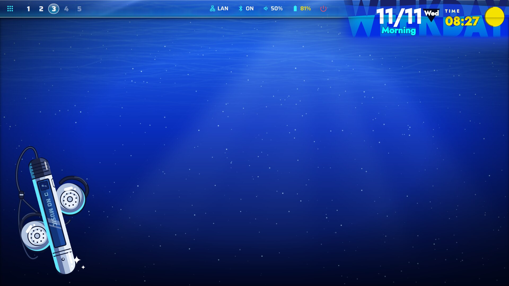

| Daily status `SUPER+I` | Loadout `SUPER+G` |
|---|---|
| 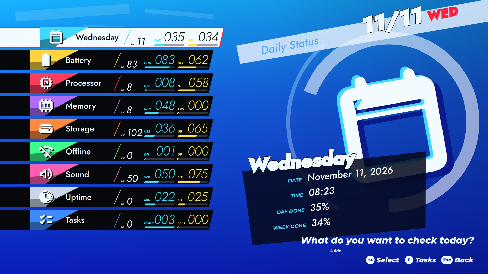 | 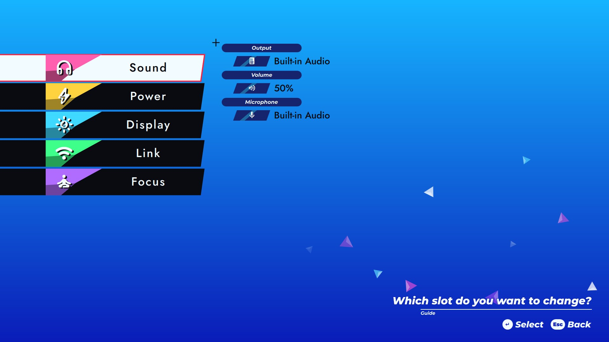 |
| **Loadout: a slot's gear** | **Toolkit `SUPER+U`** |
| 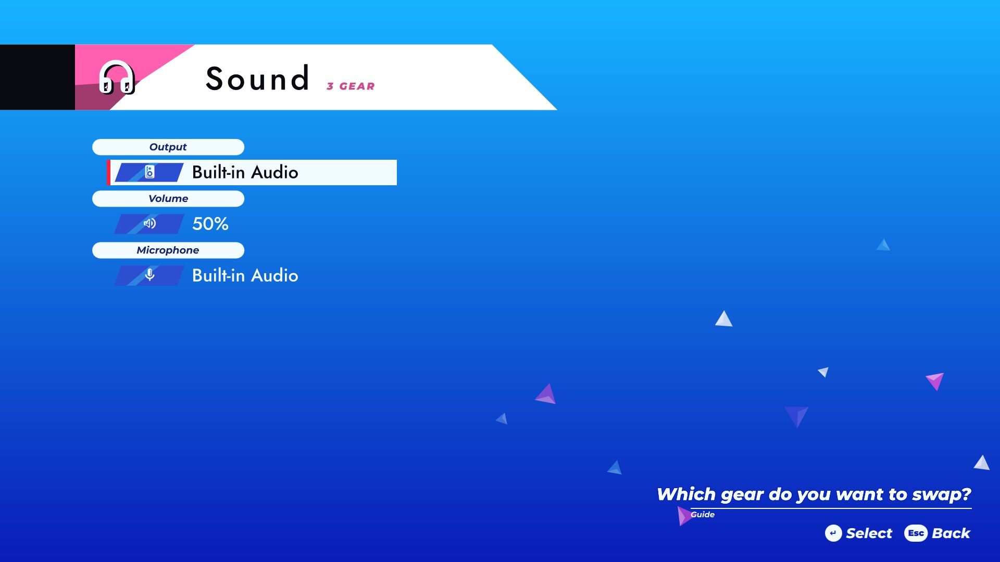 | 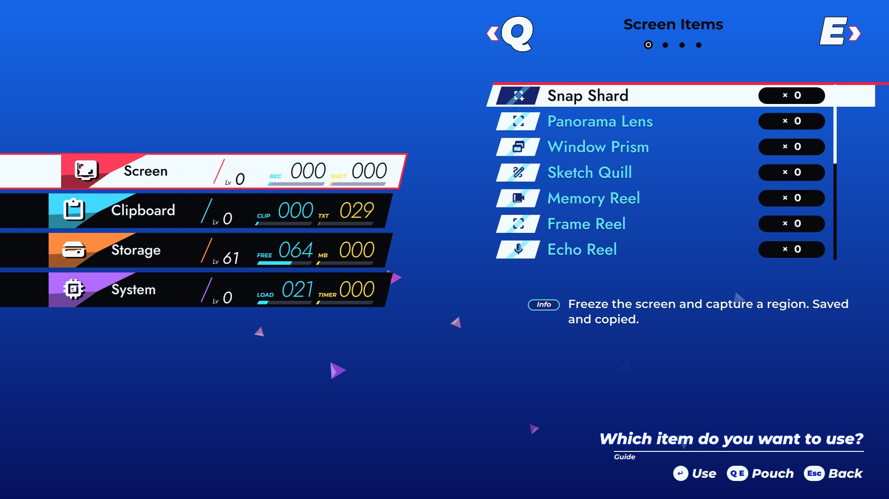 |
| **Modes `SUPER+K`** | **Launcher `SUPER+Space`** |
| 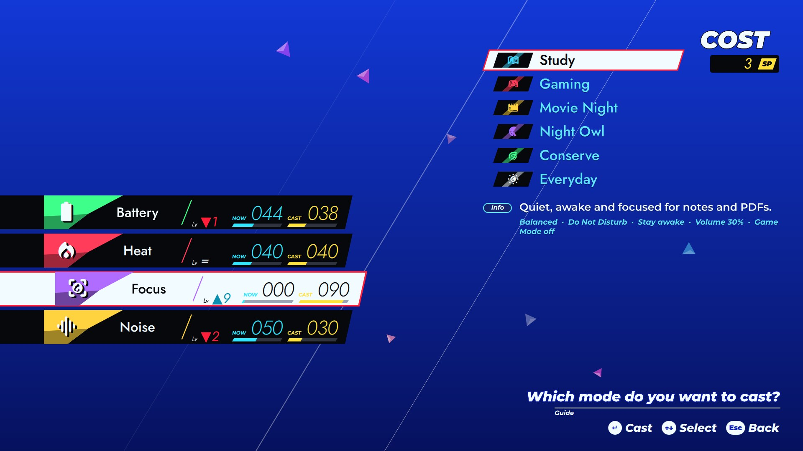 | 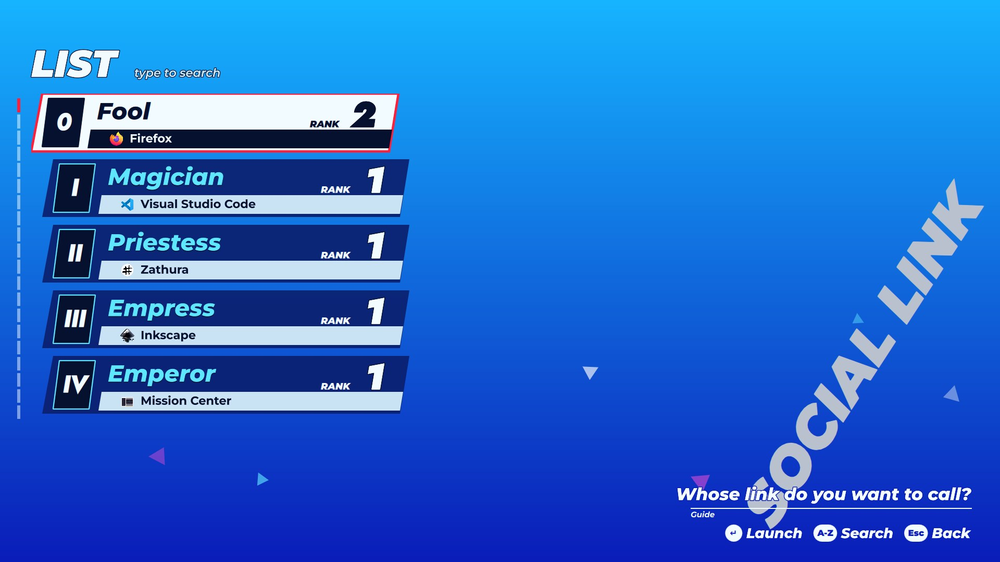 |
| **Power menu `SUPER+SHIFT+Escape`** | **Dark Hour** |
| 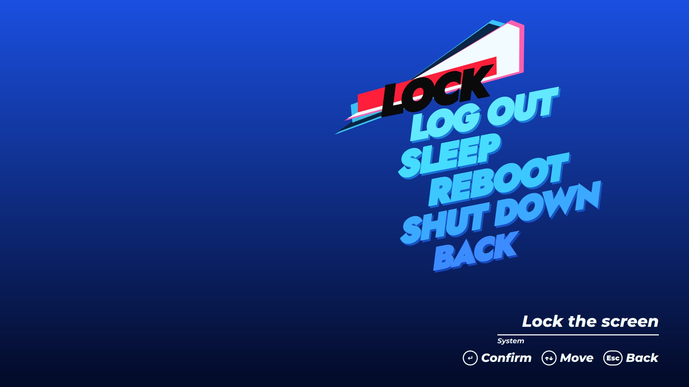 | 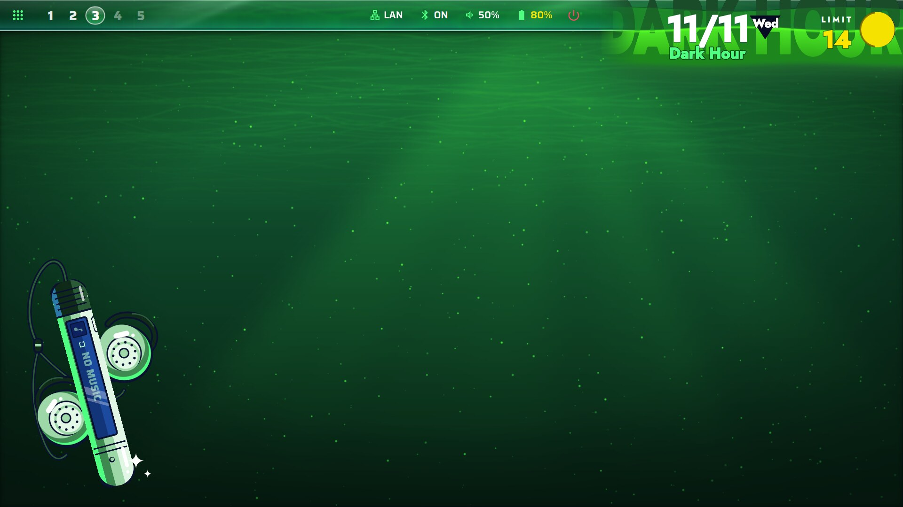 |
| **Lock screen** | **Login screen (SDDM)** |
| 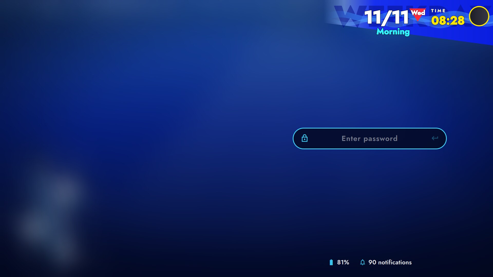 | 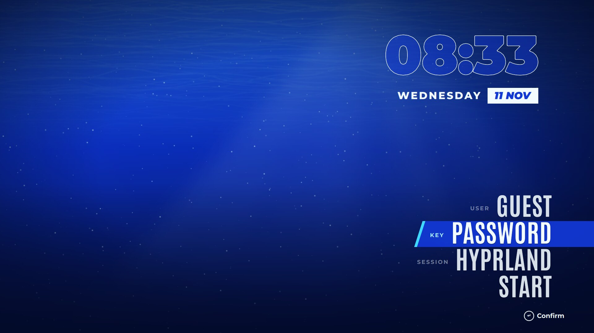 |

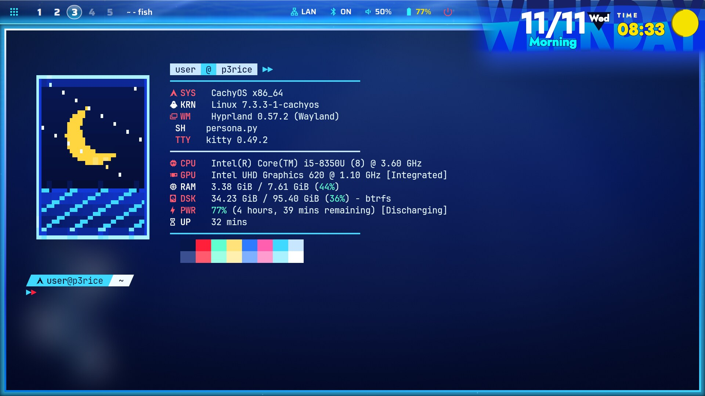

Every screenshot was taken with the media slots empty and the bundled `p3-depths.png` wallpaper, so this is what a fresh install looks like. Backdrops you add fill the open space in each menu.

## What's inside

| Piece | Key | What it is |
|---|---|---|
| `persona-bar` | | Top bar: workspaces, window title, Wi-Fi, Bluetooth, volume, battery, power. Text on a full-width "liquid glass" strip that `p3-wall` renders from the wallpaper (lensing, colour fringe, sheen). Font: Saira. |
| `p3-wall` | | Wallpaper layer. Loops a video slot, slows to a stop when Motion says so, pauses under fullscreen windows, falls back to a still image. |
| `p3-hud` | | Click-through corner calendar: date, weekday, time of day (Morning / Lunchtime / After School / Evening...), real moon phase, a wavy ribbon shader behind a giant ghost word. |
| `p3-player` | | Cel-shaded "now playing" desktop widget: a stick music player with clip-on earphones, driven by MPRIS. |
| `p3-status` | `SUPER+I` | Daily status screen: Today, Battery, CPU, Memory, Storage, Network, Sound, Uptime, Tasks, each with a level and bars. Tasks come from `~/.local/share/persona-rice/tasks.txt` (`- [ ]` / `- [x]`). |
| `p3-equip` | `SUPER+G` | Loadout screen: Sound (output, volume, mic), Power (profile, game mode, Motion, Dark Hour), Display (brightness, night light), Link (Wi-Fi, hotspot, Bluetooth), Focus (do not disturb, stay awake). Options show a before/after stat compare. |
| `p3-items` | `SUPER+U` | Toolkit in four pouches: Screen (screenshots, recordings), Clipboard, Storage (trash, caches, disk survey), System (timers, calculator, reload, lock, suspend). Destructive tools ask twice. |
| `p3-skills` | `SUPER+K` | Modes: a mode is a bundle of loadout settings (Study, Gaming, Movie Night, Night Owl, Conserve, Everyday). Shows the cost and what changes before you cast it. Override with `~/.config/p3-skills/modes.json`. |
| `p3-links` | `SUPER+Space` | App launcher as a ranked list of 20 apps, one per arcana number. Rank grows with launch count; type to search. Caelestia's launcher moves to `SUPER+SHIFT+Space`. |
| `p3-power` | `SUPER+SHIFT+Escape` | Power menu: tilted italic word stack with a sliding highlight over a video slot. |
| Lock screen | | Caelestia's lock, patched: desktop still crossfades into a video slot, corner calendar, password pill, unlock animation. |
| Login screen | | SDDM theme (`themes/p3/sddm`), optional. |
| Terminal | | Animated card greeting (sextant-character pixel art) next to fastfetch, starship prompt, fish/fzf colours, kitty palette. |

Two rules shared by every animated piece:

- **Motion** (`SUPER+G` → Power → Motion): animations ease to a stop on battery below a threshold (default 30%), or run always, or never. State in `~/.local/state/p3-motion.json`.
- **Dark Hour** (`SUPER+G` → Power → Dark Hour): at midnight, in game mode, or on demand, everything grades green: wallpaper, bar, calendar, menus, window borders, kitty palette.

Only one full-screen menu is open at a time. The menus stay resident (hidden, 0% CPU) because a cold Quickshell start takes over a second; opening takes about 75 ms.

```
themes/p3/
  theme.sh          name, Caelestia scheme, default wallpaper, autostart list
  terminal/         greeting.py, fastfetch.jsonc, colors.fish, starship.toml, kitty.conf, tools/
  caelestia/        scheme, shell.json (fonts, frame off), shell-tokens.json
  quickshell/       persona-bar, p3-*, caelestia-overlay/, caelestia-patches.py
  hypr/look.lua     borders, blur, shadows, the key binds above, autostart
  sddm/             login screen
  wallpapers/       p3-depths.png, p3-moonroom.png (original, generated)
  fonts/            Saira (SIL Open Font License)
  drafts/           earlier and rejected versions of the bar, player, calendar, lock
shared/             persona-theme (switcher), sync-caelestia.sh, fish greeting hook, hypr autostart
media/p3/           empty; put your own media here before installing (gitignored)
```

## Requirements

Arch / CachyOS package names (AUR marked):

```
hyprland quickshell fastfetch fish python
starship kitty
caelestia-shell caelestia-cli                    # AUR
qt6-multimedia qt6-shadertools                   # video slots, shader compile (qsb)
ttf-antonio otf-bebas-neue-git                   # AUR
ttf-material-symbols-variable-git                # AUR
noto-fonts ttf-jetbrains-mono-nerd
networkmanager bluez iw upower power-profiles-daemon brightnessctl
grim slurp wl-clipboard cliphist gpu-screen-recorder qalculate-gtk   # toolkit items; each is optional
```

Fonts not packaged: **Jost** (calendar, menus, lock), from [Google Fonts](https://fonts.google.com/specimen/Jost), into `~/.local/share/fonts/`. Saira is bundled in `themes/p3/fonts/`; copy it there too.

Tested with Hyprland 0.56 (Lua config), Quickshell 0.3.2, caelestia-shell 2.5.0, caelestia-cli 1.1.3 on a 1920x1080 panel at 1.5x scale. The Caelestia patches are tied to that version; if one doesn't fit, the installer says so and Caelestia runs unpatched. The binds in `look.lua` use the Lua API, so the menus need the Lua config (`look.conf` only carries the window look).

## Install

```sh
git clone https://github.com/adixno/persona3-rice
cd persona3-rice
# optional: drop your own media into media/p3/ first (see below)
./install.sh              # everything
./install.sh --terminal   # just the terminal: greeting, prompt, colours
```

The first run backs up every file the theme replaces to `~/.local/share/persona-rice/backup-<date>/`, copies the theme to `~/.local/share/persona-rice/themes/`, installs `persona-theme` to `~/.local/bin` and applies the theme. With the Lua config it appends `require("config.persona_theme")` to `hyprland.lua` (backup `hyprland.lua.bak-persona-theme`); keep that line last.

Files a theme owns are overwritten on every switch. Edit under `themes/p3/` and re-run `./install.sh`, not in `~/.config`.

After a `caelestia-shell` update:

```sh
~/.config/quickshell/sync-caelestia.sh
caelestia shell -k && caelestia shell -d
```

Login screen (needs root, separate):

```sh
sudo ./sddm-install.sh            # install the SDDM theme; your login manager is untouched
sudo ./sddm-install.sh --enable   # switch from greetd to sddm
sudo ./sddm-install.sh --revert
```

Put your own picture at `themes/p3/sddm/background.png` before running it (gitignored); otherwise the default wallpaper is used.

## Media slots

Everything below is optional and lives in `~/.local/share/persona-rice/media/p3/` (files placed in this repo's `media/p3/` are copied there by `install.sh`). Use media you own or have the right to use. The backdrops were laid out for 1920x1080 art with the subject on the left or centre and the list area clear; with a slot empty, the piece draws on a plain dark-blue background.

| File | Used by | Notes |
|---|---|---|
| `wall.mp4`, `wall-still.png` | `p3-wall` | Looping video wallpaper and its first frame (shown before the video starts). The installer seeds `wall-still.png` from `p3-depths.png` if neither exists. |
| `power-bg.mp4` | `p3-power` | Short loop behind the power menu. |
| `lock-float.mp4`, `lock-sink.mp4` | lock screen | Loop while locked; a short clip played once on unlock. |
| `status-bg/NN.png` + `offsets.json` | `p3-status` | Slideshow frames, crossfaded on each selection change. `tools/order-frames.py` orders them for least motion, `tools/offsets.py` writes the offsets. A single `status-bg.png` or `status-bg.mp4` also works. |
| `equip-bg.png`, `equip-mask.png`, `equip-sel-src.png` → `equip-bg-sel.png` | `p3-equip` | Backdrop, its motion mask (`tools/make-mask.py`), and the "slot selected" variant (`tools/make-selected.py`). |
| `items-bg.png`, `items-mask.png` | `p3-items` | Backdrop + mask (`tools/make-mask.py`). |
| `skills-bg.png`, `skills-mask.png` | `p3-skills` | Backdrop + mask (`tools/make-mask.py`). |
| `links-bg/00.png` … `19.png`, `offsets.json`, `mask.png` | `p3-links` | One frame per app; mask from `tools/make-mask.py`. |
| `greeting-card.png` | terminal | `terminal/tools/make-pixel.py <image>` turns a card image into the pixel-art card embedded in `greeting.py`. The repo ships an original moon-over-water placeholder. |

The mask tools contain hand-placed regions for the art they were written against, so expect to adjust them for different images. They need `numpy` and `pillow` (a venv is fine).

## Tweaks

- **Preview the greeting:** `python3 ~/.config/fastfetch/persona.py --still`
- **Bar height:** `barHeight` in `quickshell/persona-bar/shell.qml` and `glassH` in `quickshell/p3-wall/shell.qml` must match; `sync-caelestia.sh` reads the former.
- **Launcher apps:** the list at the top of `quickshell/p3-links/shell.qml`.
- **Modes:** `quickshell/p3-skills/modes.json`, or your own at `~/.config/p3-skills/modes.json`.
- **Shaders:** after editing a `.frag`, recompile: `/usr/lib/qt6/bin/qsb --qt6 -o x.frag.qsb x.frag`.
- **Idle CPU:** everything is measured to sit near 0% when hidden or still. Open menus with animated backdrops use roughly a quarter to a third of a core at 60 fps.

## Uninstall

Restore files from the backup folder, then delete `~/.local/share/persona-rice`, `~/.local/state/persona-theme`, `~/.local/state/p3-*.json`, `~/.local/bin/persona-theme`, `~/.config/quickshell/{persona-bar,p3-*,caelestia,caelestia-overlay,caelestia-patches.py,sync-caelestia.sh}`, `~/.config/fish/conf.d/persona-{greeting,colors}.fish`, `~/.config/kitty/themes/persona.conf` (and its `include` line), and the `persona_theme` line in `hyprland.lua`. Then `caelestia shell -k && caelestia shell -d`. Login screen: `sudo ./sddm-install.sh --revert`, then remove `/usr/share/sddm/themes/persona-*`, `/usr/local/bin/persona-sddm-theme`, `/etc/sudoers.d/persona-sddm-theme`, `/etc/sddm.conf.d/persona.conf`.

## License

MIT for the code. Saira is under the SIL Open Font License.
